<!-- ═══════════════════════════ HERO ═══════════════════════════ -->
<div align="center">


<a href="https://github.com/i-Anurag1/OSTutorLLM">
  
</a>

<br/>


<br/>

[🚀 Quick Start](#-quick-start) •
[🎬 How It Works](#-how-it-works--the-cinematic-pipeline) •
[🏗️ Architecture](#%EF%B8%8F-system-architecture) •
[🧪 Simulators](#-simulators) •
[🎓 Fine-tuning](#-fine-tuning-qlora) •
[📊 Evaluation](#-evaluation--honest-numbers)

</div>


## 🎞️ Teaser

```text
+----------------------------------------------------------------------+
|                                                                      |
| [USER]   "What is Belady's anomaly?"                                 |
|                                                                      |
| [RAG]    retrieving  ####################  100%   BM25+TF-IDF+BGE    |
| [GATE]   evidence coverage ................ 0.83   OK (>= 0.40)      |
| [LLM]    Qwen3 streaming over SSE ......... _                        |
|                                                                      |
| | Belady's anomaly: FIFO page replacement can fault MORE      [S1]   |
| | as frames increase (e.g. 9 -> 10 faults).                   [S1]   |
| : (dashed amber bar = claim the evidence does not support)           |
|                                                                      |
| [USER]   "Explain quantum computing"                                 |
| [GATE]   coverage below threshold -> NO LLM CALL                     |
| [TUTOR]  "My course notes do not cover this. I won't guess."         |
|                                                                      |
+----------------------------------------------------------------------+
```

> **OSTutor** answers Operating Systems questions using **only your course material**, and marks **every sentence** with the source that supports it.
> Around the tutor sit step-through simulators, sandboxed code labs, server-scored quizzes with viva grading, a mastery dashboard, and a retrieval lab that shows exactly what the tutor saw.
> Runs locally with **Docker + Ollama** — **no cloud API key needed.**
---

## 📑 Table of Contents

<details open>
<summary><b>Click to expand / collapse</b></summary>

1. [✨ Feature Universe](#-feature-universe)
2. [🚀 Quick Start](#-quick-start)
3. [🎬 How It Works — The Cinematic Pipeline](#-how-it-works--the-cinematic-pipeline)
4. [🏗️ System Architecture](#%EF%B8%8F-system-architecture)
5. [🔍 Hybrid RAG Deep Dive](#-hybrid-rag-deep-dive)
6. [🛡️ Grounding & Evidence Lanes](#%EF%B8%8F-grounding--evidence-lanes)
7. [🧪 Simulators](#-simulators)
8. [💻 Code Labs & Sandbox](#-code-labs--sandbox)
9. [📝 Practice, Quizzes & Viva](#-practice-quizzes--viva)
10. [🗄️ Data Model](#%EF%B8%8F-data-model)
11. [🔌 API Reference](#-api-reference)
12. [🎓 Fine-tuning (QLoRA)](#-fine-tuning-qlora)
13. [📊 Evaluation — Honest Numbers](#-evaluation--honest-numbers)
14. [⚙️ Configuration](#%EF%B8%8F-configuration)
15. [📚 Adding Your Own Material](#-adding-your-own-material)
16. [🔐 Security Model](#-security-model)
17. [🧯 Troubleshooting](#-troubleshooting)
18. [📁 Project Structure](#-project-structure)
19. [🗺️ Roadmap](#%EF%B8%8F-roadmap)
20. [🤝 Contributing](#-contributing)

</details>

---

## ✨ Feature Universe

<div align="center">

| 🌌 Module | 💎 What you get |
|:---:|:---|
| 🧠 **Tutor** | Streaming answers · **Teach / Socratic / Exam** modes · adaptive level · conversation history · 👍/👎 feedback · follow-up suggestions · **Evidence lanes** (coloured margin bar per supporting source, dashed amber for unsupported claims) · `[S#]` chips that open the exact passage · **declines** when notes don't cover the question |
| 🔍 **RAG** | Heading-aware chunking · own **BM25 + TF-IDF** (uni/bigram) · glossary query expansion (LRU, TLB, FCFS…) · dense **BGE** vectors (NumPy or **FAISS**) · weighted **RRF** fusion · optional cross-encoder rerank · **MMR** diversification · evidence-coverage confidence & abstention · self-rebuilding fingerprinted index |
| 🎛️ **Simulators** | CPU scheduling (6 algos + compare) · page replacement (FIFO/LRU/Optimal/Clock/LFU, Belady's anomaly) · paging + TLB · segmentation · disk scheduling (6) · Banker's algorithm · producer–consumer · dining philosophers · thread life cycle |
| 💻 **Code Labs** | Python & shell sandboxes with **9 auto-graded exercises** · import allow-list · restricted bash · unprivileged user · CPU/memory/output limits |
| 📝 **Practice** | **62 MCQs + 8 viva questions** across **20 topics** · scored **server-side** (answers never reach the browser early) |
| 📚 **Knowledge** | Retrieval lab (per-stage scores) · source upload with live indexing · benchmark evaluation · system status |
| 📈 **Progress** | Mastery dashboard · per-topic tracking · faculty/admin analytics |
| 🎓 **Fine-tuning** | Original dataset + full **QLoRA** pipeline · GGUF export · Ollama Modelfile · model comparison script |

</div>

---

## 🚀 Quick Start

### 📦 Prerequisites

| Tool | Why | Link |
|---|---|---|
| 🐳 **Docker Desktop** | Runs db, redis, api, worker, web | https://www.docker.com/products/docker-desktop |
| 🦙 **Ollama** *(recommended)* | Local LLM host | https://ollama.com/download |

### ▶️ Launch

```bash
# Windows  → double-click RUN.bat
# macOS / Linux
git clone https://github.com/i-Anurag1/OSTutorLLM.git
cd OSTutorLLM
./scripts/start.sh
```

The launcher will:

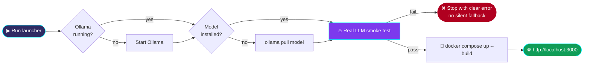

### 🔑 Demo accounts

| Role | Email | Password |
|:---:|---|---|
| 🎓 Student | `student@ostutor.local` | `Student123!` |
| 👩‍🏫 Faculty | `faculty@ostutor.local` | `Faculty123!` |
| 🛠️ Admin | `admin@ostutor.local` | `Admin123!` |

> ⚠️ Normal launcher mode sets `LLM_REQUIRED=1`: if Ollama is unavailable you get a **clear error**, not a silent extractive answer. Set `LLM_REQUIRED=0` in `.env` only if you deliberately want notes-only mode.
>
> ⚡ Retrieval works **immediately** (BM25). The dense embedding model downloads in the background and upgrades search to **hybrid** without a restart — watch **Knowledge → System**.

### 🌍 Service map

| Service | Port | Purpose |
|---|:---:|---|
| `web` | **3000** | Next.js UI |
| `api` | **8000** | FastAPI backend (`/health`, `/api/...`) |
| `db` | — | PostgreSQL 16 |
| `redis` | — | Cache + ingestion queue |
| `worker` | — | RQ worker for re-indexing |

---

## 🎬 How It Works — The Cinematic Pipeline

<div align="center">

### 🎥 Scene-by-scene: one question, five acts

</div>

```mermaid
sequenceDiagram
    autonumber
    actor S as 🧑‍🎓 Student
    participant UI as 🖥️ Next.js UI
    participant API as ⚡ FastAPI
    participant R as 🔍 Hybrid RAG
    participant L as 🧠 Ollama (Qwen3)
    participant G as 🛡️ Grounding

    S->>UI: "What about LRU?"
    UI->>API: POST /api/tutor/stream
    rect rgb(30, 30, 70)
    Note over API,R: ACT 1 — Contextualise
    API->>API: prefix previous question (retrieval only)
    API->>R: search(query)
    Note over R: ACT 2 — Retrieve<br/>glossary expansion → BM25 + TF-IDF + BGE<br/>→ RRF → rerank → MMR (λ 0.72)
    R-->>API: top chunks + coverage score
    end
    alt coverage < RAG_MIN_COVERAGE
        API-->>UI: 🚫 polite decline (no LLM call)
    else enough evidence
        rect rgb(20, 60, 60)
        Note over API,L: ACT 3 — Generate
        API->>L: numbered evidence [S1..Sn] + mode + level
        L-->>API: token stream (think blocks filtered)
        API-->>UI: SSE tokens ▌▌▌
        end
        rect rgb(60, 30, 60)
        Note over API,G: ACT 4 — Check
        API->>G: score every sentence vs cited chunk
        G-->>API: support report (unknown [S#] stripped)
        end
        API-->>UI: ACT 5 — evidence lanes + citations
    end
    UI-->>S: ┃ colour-barred, clickable [S#] answer
```

### 🧬 Decision flow

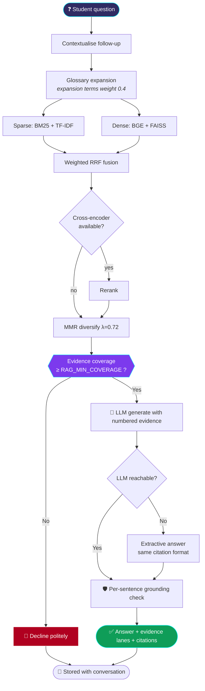

---

## 🏗️ System Architecture

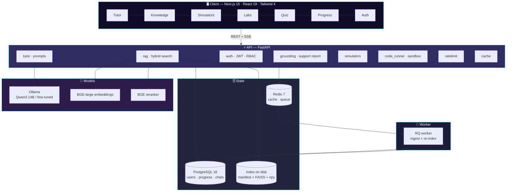

### 🐳 Container topology

```mermaid
graph LR
    subgraph Docker Compose
        WEB[web :3000] -->|depends_on healthy| API[api :8000]
        API -->|healthy| DB[(db postgres:16-alpine)]
        API -->|healthy| REDIS[(redis:7-alpine)]
        WRK[worker] --> DB
        WRK --> REDIS
    end
    API -.host.docker.internal:11434.-> HOST[🦙 Ollama on host]
    API --- V1[(hf_cache volume)]
    WRK --- V1
    API --- V2[/backend/data/]
    WRK --- V2
```

---

## 🔍 Hybrid RAG Deep Dive

### ⚡ Two-phase index — usable in ~20 ms

```mermaid
gantt
    title Index lifecycle (first start)
    dateFormat  X
    axisFormat  %s
    section Phase 1 · Sparse
    BM25 + TF-IDF built (~20 ms / 105 chunks) :done, p1, 0, 1
    Search is LIVE                            :milestone, m1, 1, 0
    section Phase 2 · Dense
    Download embedding model (background)     :active, p2, 1, 6
    Compute embeddings (background thread)    :active, p3, 6, 10
    Index upgraded in place → HYBRID          :milestone, m2, 10, 0
```

| Stage | What it does |
|---|---|
| ✂️ **Chunking** | Markdown headings (DOCX heading styles, PPTX slide titles) define sections. Each chunk keeps `title › section`, also prepended to indexed text. ≤ **900 chars**, ≤ **120 chars** word-aligned overlap |
| 📖 **Glossary expansion** | `LRU → least recently used`, `TLB`, `FCFS`… (expansion terms weigh **0.4** vs the student's own words) |
| 🔤 **Sparse** | Own **BM25** + uni/bigram **TF-IDF** |
| 🧬 **Dense** | **BAAI/bge-large-en-v1.5** → NumPy inner product or **FAISS** |
| 🔀 **Fusion** | Weighted **Reciprocal Rank Fusion** |
| 🎯 **Rerank** | Optional **BAAI/bge-reranker-base** cross-encoder |
| 🌈 **MMR** | λ = **0.72** — avoids five near-identical chunks |
| ⚖️ **Confidence** | IDF-weighted share of key terms in top-3 chunks. Terms absent from the whole corpus count most |
| 🔁 **Self-healing** | Manifest + corpus fingerprint → reuse at start-up, rebuild on change, reload when the worker re-indexes (API watches manifest mtime) |

> 🛟 **Graceful degradation:** no `sentence-transformers` → sparse only. No FAISS → NumPy inner product. Nothing crashes.

### 🧩 Retrieval funnel

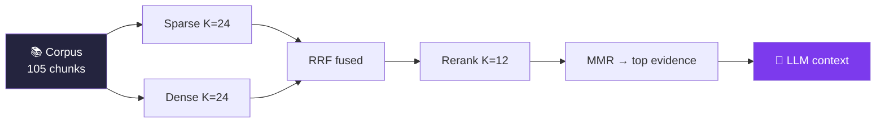

---

## 🛡️ Grounding & Evidence Lanes

Every generated sentence is scored against the chunk it cites.

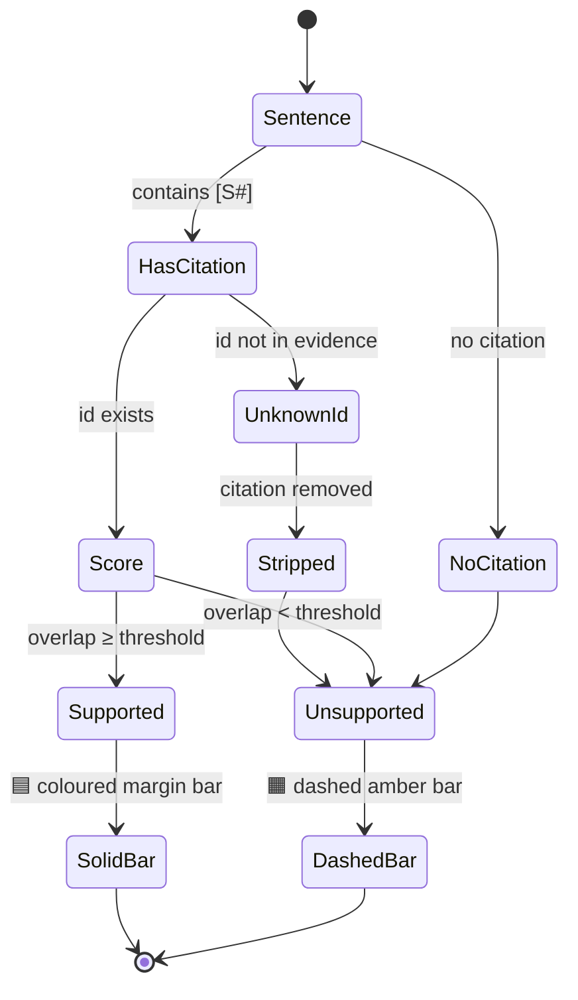

| Visual | Meaning |
|:---:|---|
| 🟦🟩🟪 solid coloured bar | Sentence supported by that source |
| 🟧 dashed amber bar | Claim the evidence does **not** support |
| `[S3]` chip | Click to open the exact passage |
| 🚫 decline message | Notes don't cover the question |

---

## 🧪 Simulators

All simulators are **step-through** and **verified against textbook results**.

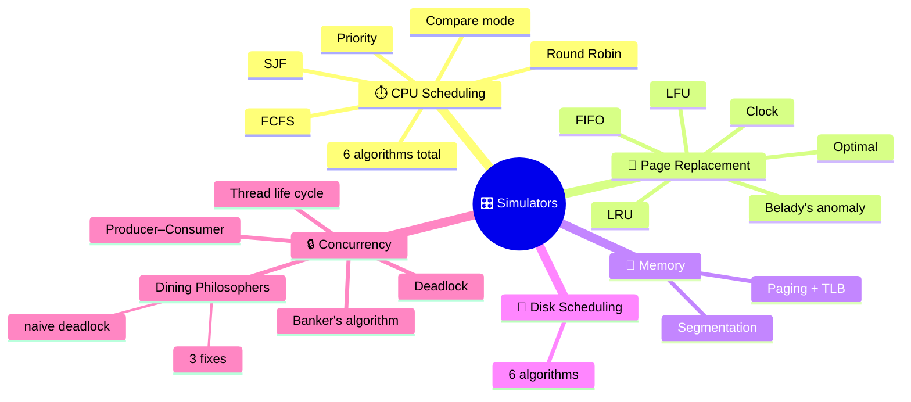

### ✅ Textbook checks (asserted in `test_simulators.py`)

| Scenario | Expected |
|---|---|
| FCFS / SJF / RR on the 24/3/3 example | textbook waiting times |
| Page faults FIFO / LRU / OPT | **15 / 12 / 9** |
| Belady's anomaly (FIFO) | **9 → 10** faults |
| Banker's safe sequence | **P1, P3, P4, P0, P2** |
| Disk totals | **640 / 236 / 331 / 382 / 299 / 322** |

### 🎞️ Example: Belady's anomaly, animated in your head

```text
Frames = 3                          Frames = 4
 1  2  3  4  1  2  5  1  2  3  4  5      → 9 faults
[1][1][1][4][4][4][5][5][5][5][5][5]
   [2][2][2][1][1][1][1][1][3][3][3]
      [3][3][3][2][2][2][2][2][4][4]
 F  F  F  F  F  F  F  .  .  F  F  .

 …with 4 frames FIFO faults 10 times.   More memory ⇒ MORE faults. 🤯
```

---

## 💻 Code Labs & Sandbox

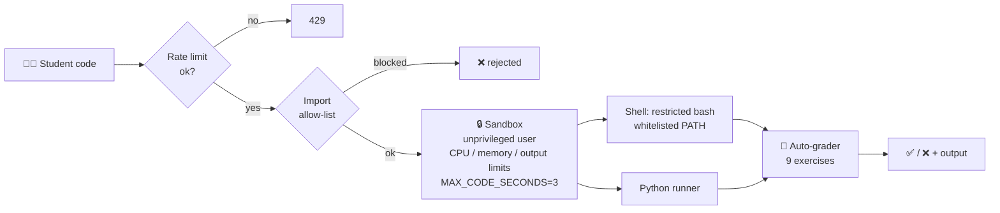

> 🏫 Sandboxed for a **classroom** setting — not hostile multi-tenant hosting. See [Security Model](#-security-model).

---

## 📝 Practice, Quizzes & Viva

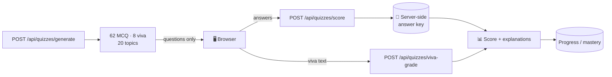

---

## 🗄️ Data Model

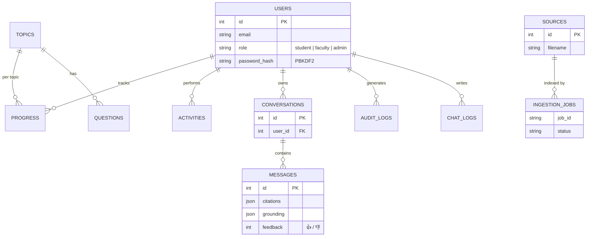

> Tables: `users, topics, progress, activities, chat_logs, sources, questions, ingestion_jobs, audit_logs` + `conversations`, `messages`. Migrations via **Alembic**; `create_all` upgrades existing databases without touching old rows.

---

## 🔌 API Reference

<details>
<summary><b>🔐 Auth & Profile</b></summary>

| Method | Endpoint |
|:---:|---|
| `POST` | `/api/auth/register` |
| `POST` | `/api/auth/login` |
| `GET` | `/api/auth/me` |
| `PUT` | `/api/profile` |
| `GET` | `/health` · `/api/system/status` |

</details>

<details>
<summary><b>🧠 Tutor</b></summary>

| Method | Endpoint |
|:---:|---|
| `POST` | `/api/tutor/chat` |
| `POST` | `/api/tutor/stream` *(SSE)* |
| `GET` | `/api/tutor/conversations` |
| `GET` / `DELETE` | `/api/tutor/conversations/{cid}` |
| `POST` | `/api/tutor/messages/{mid}/feedback` |

</details>

<details>
<summary><b>🔍 Knowledge & RAG</b></summary>

| Method | Endpoint |
|:---:|---|
| `POST` | `/api/rag/search` |
| `GET` | `/api/rag/status` |
| `POST` | `/api/rag/rebuild` |
| `GET` | `/api/rag/jobs/{job_id}` |
| `GET` / `POST` | `/api/sources` · `/api/sources/upload` |
| `DELETE` | `/api/sources/{sid}` |
| `POST` | `/api/evaluation/retrieval` · `/api/evaluation/run` |

</details>

<details>
<summary><b>🎛️ Simulators</b></summary>

| Method | Endpoint |
|:---:|---|
| `POST` | `/api/simulators/cpu` · `/cpu/compare` |
| `POST` | `/api/simulators/page-replacement` · `/page-replacement/compare` |
| `POST` | `/api/simulators/banker` · `/deadlock` · `/disk` |
| `POST` | `/api/simulators/producer-consumer` · `/dining-philosophers` |
| `POST` | `/api/simulators/paging` · `/segmentation` · `/threads` |

</details>

<details>
<summary><b>💻 Labs · 📝 Quizzes · 📈 Progress · 🛠️ Admin</b></summary>

| Method | Endpoint |
|:---:|---|
| `GET` | `/api/labs/exercises` |
| `POST` | `/api/labs/shell` · `/api/labs/python` · `/api/labs/test` |
| `POST` | `/api/quizzes/generate` · `/score` · `/viva-grade` |
| `GET` / `POST` | `/api/topics` · `/api/dashboard` · `/api/progress` |
| `GET` | `/api/admin/analytics` · `/api/admin/students` |

</details>

> 📖 Interactive docs once running: **http://localhost:8000/docs**

---

## 🎓 Fine-tuning (QLoRA)

> **Honest status:** the repo ships a complete, tested **pipeline** and an original preprocessed **dataset**, but **no trained weights** (no GPU was available when it was assembled). Until you train one, the app runs stock `qwen3:14b`.

### 🎯 What fine-tuning teaches

Facts come from **retrieval**, not weights. Fine-tuning teaches **behaviour**: cite with `[S#]` using only ids that exist · copy claims faithfully · **decline** when evidence is missing · follow Teach / Socratic / Exam · solve worked problems step by step.

### 🧱 Dataset sources

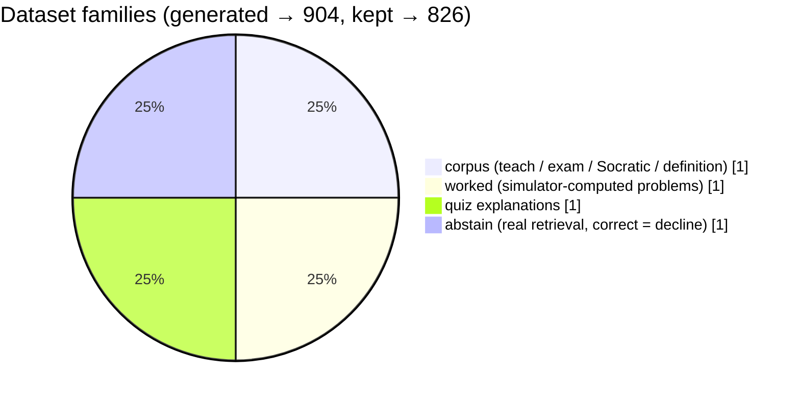

| Source | What it is |
|---|---|
| 📚 **corpus** | The project's own OS corpus restructured into teach / exam / Socratic / definition answers |
| 🧮 **worked** | Random numeric problems whose answers are **computed by `simulators.py`** → correct by construction |
| ❓ **quiz** | Explanations from the authored question bank |
| 🚫 **abstain** | Off-topic & near-miss questions paired with *real* retrieval output; correct answer = decline |

### 🧼 9-stage preprocessing pipeline

```mermaid
flowchart LR
    S0[904 generated] --> S1[1 · Unicode NFKC<br/>+ whitespace]
    S1 --> S2[2 · PII / link /<br/>long-number scrub]
    S2 --> S3[3 · Length + ASCII<br/>ratio filters]
    S3 --> S4[4 · Citation<br/>integrity]
    S4 --> S5[5 · Groundedness]
    S5 --> S6[6 · Exact dedup<br/>−20]
    S6 --> S7[7 · Near-dup<br/>3-gram Jaccard ≥ 0.9]
    S7 --> S8[8 · Benchmark<br/>decontamination]
    S8 --> S9[9 · Grouped 80/10/10<br/>split]
    S9 --> OUT[✅ 826 kept<br/>647 train · 88 val · 91 test]
    style OUT fill:#0f9d58,color:#fff
    style S0 fill:#302b63,color:#fff
```

### 🏋️ Train on a free GPU

```bash
pip install -r training/requirements-train.txt
python training/train_qlora.py --base Qwen/Qwen3-8B     # ~10 GB VRAM · use Qwen3-14B with 24 GB
python training/merge_and_export.py                      # merge LoRA, write Modelfile, GGUF steps
ollama create ostutor-qwen3 -f training/outputs/ostutor-merged/Modelfile
```

Then set `LLM_MODEL=ostutor-qwen3` in `.env`. Or open **`training/colab_finetune.ipynb`** in Google Colab (T4).

| Hyper-parameter | Value |
|---|---|
| Method | **QLoRA 4-bit NF4** |
| LoRA | r = **16** · alpha = **32** · all attention + MLP projections |
| Schedule | cosine · lr **2e-4** · **3** epochs |
| Loss | assistant answer **only** (label masking) |
| Checkpoint | best by validation loss |

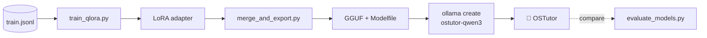

### 📏 Measure it

```bash
python training/evaluate_models.py --models qwen3:8b ostutor-qwen3 --limit 80
python training/evaluate_models.py --selftest      # reference = 1.0, degenerate baselines ≈ 0
```

Reports: valid-citation rate · citation rate · groundedness · abstention accuracy · exact match on computed problems / quiz answers.

---

## 📊 Evaluation — Honest Numbers

### 🏁 Retrieval benchmark (sparse path · 105 chunks · 40 in-scope + 5 off-topic probes)

| Variant | Recall@5 | MRR | nDCG@5 | Hit@1 |
|---|:---:|:---:|:---:|:---:|
| BM25 only | 1.000 | 0.983 | 0.991 | 0.975 |
| TF-IDF (uni+bi) only | 0.992 | 0.988 | 0.982 | 0.975 |
| BM25 + TF-IDF, no expansion | 1.000 | 0.971 | 0.980 | 0.950 |
| + glossary expansion | 1.000 | 0.988 | 0.991 | 0.975 |
| **+ MMR (shipped)** | **1.000** | **0.988** | **0.991** | **0.975** |

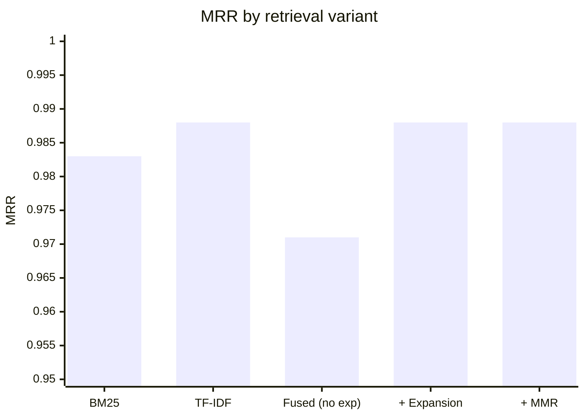

### ✅ Verification — what was actually run

| Check | Result |
|---|---|
| Backend logic tests (RAG, grounding, simulators vs textbook, sandbox security, LLM stream filter) | ✅ **77 pass** — `python scripts/verify.py` (no Docker needed) |
| Training pipeline tests (each stage, split leakage, format, metrics, label masking) | ✅ **13 pass** |
| Retrieval benchmark | ✅ Recall@5 **1.00** · MRR **0.988** · nDCG@5 **0.991** · Hit@1 **0.975** |
| Abstention | ✅ **0/40** false abstentions · **4/5** off-topic declined |
| Frontend strict TypeScript check + server-render of every screen | ✅ clean, **28/28** |
| ⏳ **Not run in the build environment** | API with live DB · `docker compose up` · `next build` · dense/rerank models · real LLM output · model training |

### 🧐 Honest reading

> The benchmark was written **alongside the corpus**, so it is a **regression check**, not an unseen test — even BM25 alone nearly maxes it. These numbers show nothing regressed and fusion/expansion don't hurt; they do **not** prove dense retrieval or reranking help. Off-topic detection is a heuristic (the miss: *"Explain how quantum computing works"*, coverage 0.41 vs threshold 0.40). A harder, independently written benchmark is the next step.

Reproduce everything offline: `python scripts/verify.py` · in-app: **Knowledge → Evaluation**.

---

## ⚙️ Configuration

Copy `.env.example` → `.env` (the launcher does this for you). Everything has a working default.

| Variable | Default | Purpose |
|---|---|---|
| `LLM_MODEL` | `qwen3:14b` | Set `ostutor-qwen3` after fine-tuning |
| `LLM_BASE_URL` | `http://host.docker.internal:11434/v1` | Ollama or any OpenAI-compatible server |
| `LLM_REQUIRED` | `1` | `0` = allow extractive-only fallback |
| `LLM_NUM_PREDICT` | `900` | Max generated tokens |
| `LLM_TIMEOUT` | `300` | Seconds |
| `EMBEDDING_MODEL` | `BAAI/bge-large-en-v1.5` | Dense retrieval |
| `RERANKER_MODEL` | `BAAI/bge-reranker-base` | Cross-encoder rerank |
| `RAG_DENSE_K` / `RAG_SPARSE_K` / `RAG_RERANK_K` | `24 / 24 / 12` | Candidate pool sizes |
| `RAG_MIN_COVERAGE` | `0.4` | Abstention threshold (0–1) |
| `CACHE_TTL_SECONDS` | `900` | Redis cache TTL |
| `MAX_CODE_SECONDS` | `3` | Code-lab time limit |
| `JWT_SECRET` | *(dev default)* | **Change before sharing!** |
| `CORS_ORIGINS` | `http://localhost:3000` | Allowed origins |
| `NEXT_PUBLIC_API_URL` | `http://localhost:8000` | Frontend → API |

---

## 📚 Adding Your Own Material

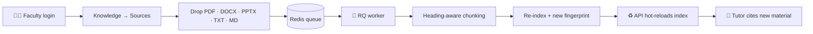

Headings become **citable sections**. Indexing runs in the background; the tutor uses new material as soon as it finishes.

---

## 🔐 Security Model

| Layer | Protection |
|---|---|
| 🔑 Auth | JWT · PBKDF2 password hashing |
| 👥 RBAC | `student` < `faculty` < `admin` |
| 🚦 Abuse | Login & lab rate limits *(in-memory, per API process)* |
| 🧾 Quizzes | Server-side scoring — answers never reach the browser early |
| 💬 Chats | Conversation ownership checks |
| 🏝️ Code labs | Import allow-list · restricted bash · whitelisted PATH · unprivileged user · CPU/memory/output limits |

> ⚠️ Built for a **trusted classroom machine**. Change `JWT_SECRET`, and **do not expose port 8000 publicly**.

---

## 🧯 Troubleshooting

| Symptom | Fix |
|---|---|
| ❌ Model check fails at startup | Start Ollama → `ollama pull qwen3:14b` (or set `LLM_MODEL` to a model you have) → re-run launcher. Check host URL in `.env` |
| 🐢 Keyword search instead of Hybrid | Embedding model still downloading (first start) or unreachable — see **Knowledge → System** |
| 🔌 Port in use | Change the left side of `ports:` in `docker-compose.yml` |
| 📜 Need logs | `docker compose logs api --tail=100` |
| 🧪 Run backend tests in Docker | `docker compose run --rm api pytest -q tests` |
| 🏗️ Verify frontend build | `cd frontend && npm run build` |

---

## 📁 Project Structure

```text
OSTutorLLM/
├── 🐍 backend/
│   ├── app/
│   │   ├── main.py            # FastAPI routes
│   │   ├── rag.py             # hybrid retrieval (BM25 · TF-IDF · BGE · RRF · MMR)
│   │   ├── tutor.py           # prompt building (Teach / Socratic / Exam)
│   │   ├── grounding.py       # per-sentence support report
│   │   ├── llm.py · llm_utils.py   # Ollama client + stream filter
│   │   ├── simulators.py      # CPU · pages · disk · Banker's · philosophers …
│   │   ├── code_runner.py     # layered sandbox
│   │   ├── exercises.py       # 9 auto-graded labs
│   │   ├── evaluation.py      # retrieval + answer benchmarks
│   │   ├── worker.py          # RQ ingestion worker
│   │   ├── auth.py · ratelimit.py · cache.py · models.py · schemas.py
│   ├── data/
│   │   ├── documents/         # 16 course notes (markdown)
│   │   ├── question_bank.json # 62 MCQ + 8 viva
│   │   ├── benchmarks/        # os_questions.json
│   │   └── index/             # FAISS + embeddings + manifest
│   ├── alembic/               # migrations
│   └── tests/                 # api · rag · simulators · sandbox · llm_utils
├── ⚛️ frontend/
│   ├── app/                   # Next.js app router
│   ├── components/            # Tutor · Knowledge · Sims · Labs · Quiz · Progress · Auth
│   └── lib/                   # api client · markdown · icons · types
├── 🎓 training/               # dataset builder · QLoRA · export · evaluate · Colab
├── 📖 docs/                   # architecture.md · evaluation.md
├── 🛠️ scripts/                # start.sh/ps1 · verify.py · self_test.py · use-finetuned.*
├── 🐳 docker-compose.yml
├── ▶️ RUN.bat · TEST-ALL.bat
└── 🔧 .github/workflows/ci.yml
```

### 🧰 Tech stack at a glance

<div align="center">


<br/><br/>

| Layer | Technology |
|:---:|---|
| 🖥️ Frontend | Next.js 15.3 · React 19 · TypeScript 5.8 · Tailwind CSS 4 |
| ⚡ Backend | FastAPI · Uvicorn · SQLAlchemy 2 · Alembic · Pydantic Settings |
| 🗄️ Storage | PostgreSQL 16 · Redis 7 · RQ |
| 🔍 Retrieval | Own BM25/TF-IDF · sentence-transformers (BGE) · FAISS · NumPy/SciPy |
| 📄 Ingestion | pypdf · python-docx · python-pptx |
| 🧠 LLM | Ollama · Qwen3 14B (or your fine-tuned `ostutor-qwen3`) |
| 🎓 Training | QLoRA (4-bit NF4) · GGUF · Ollama Modelfile |
| ✅ Testing | pytest · pytest-asyncio · strict `tsc` |
| 🚢 DevOps | Docker Compose · GitHub Actions |

</div>

---

## 🗺️ Roadmap

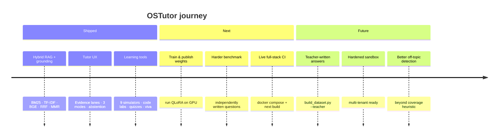

- [ ] Train and publish a fine-tuned `ostutor-qwen3` checkpoint
- [ ] Independent, harder retrieval benchmark to measure dense/rerank gains
- [ ] Distributed rate limiter (currently per API process)
- [ ] Stronger off-topic detection than the coverage heuristic
- [ ] Teacher-model dataset generation run (`--teacher`)

---

## 🤝 Contributing

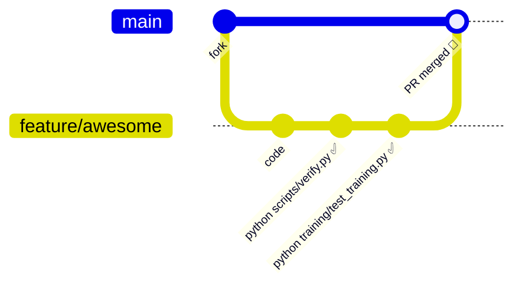

1. 🍴 Fork the repo
2. 🌿 Create a branch: `git checkout -b feature/awesome`
3. ✅ Run `python scripts/verify.py` (no Docker needed)
4. 📬 Open a Pull Request

---

<div align="center">

### 📈 Live repo stats


<br/>


<br/>


</div>
